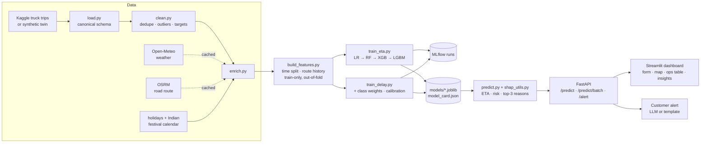

# Arrivo — Shipment ETA Prediction & Delay Risk Engine

> Final-year B.Tech CSE (AI/ML) major project · Python · scikit-learn / XGBoost / LightGBM · SHAP · FastAPI · Streamlit · Docker

Late deliveries cost logistics companies money and customer trust. **Arrivo** looks at a truck shipment *at the moment it is dispatched* and predicts:

| Output | Type | Example |
|---|---|---|
| **ETA** | Regression | 85.6 hrs → arrives Thu 24 Jul, 08:05 |
| **Delay risk** | Calibrated classification | 97.6% chance of arriving late → **High** |
| **Top reasons** | SHAP explanations | "Rain at origin (32 mm) and destination (31 mm) (+10.5 hrs)" |

Users: logistics operations managers who need to spot at-risk shipments early and warn customers before they complain.

**🔴 Live demo:** [arrivo-eta.streamlit.app](https://arrivo-eta.streamlit.app) — the free Streamlit server sleeps when idle; if you see "Zzzz", click *Yes, get this app back up* and wait ~30 s.

---

## Detailed project summary

### 1. The problem
Every truck shipment leaves with a *planned* ETA, usually computed by a simple rule: distance ÷ nominal speed + a fixed buffer. That rule ignores everything that actually slows trucks down in India: monsoon rain, festival traffic around Diwali or Holi, hilly roads, rush-hour city exits, routes that are chronically congested and transport suppliers that load late. In our data about **36% of shipments arrive later than planned**. Operations teams usually find out only when the customer calls to complain.

Arrivo's goal is to flag those shipments **at the moment of dispatch**, while there is still time to act: re-route, swap the vehicle, warn the warehouse, or tell the customer early.

### 2. What the system does
For each shipment, given only information available at dispatch (origin, destination, dispatch time, vehicle, cargo, supplier, weather, calendar), Arrivo returns:
1. **ETA**: predicted transit hours and expected arrival date/time (regression).
2. **Delay risk**: a calibrated probability that the shipment will be late, mapped to **Low / Medium / High** (classification).
3. **Top 3 reasons**: the factors that pushed this prediction up or down, in plain English with their effect in hours, e.g. *"Festival-season traffic (2 days from a major festival) (+1.7 hrs)"* (explainability with SHAP).
4. **Customer alert**: a short, polite message for the customer, written by an LLM (any OpenAI-compatible API) or a fixed template.

### 3. How it works, end to end

**Step 1: Data loading** (`src/data/load.py`). The recommended dataset is Kaggle's *Delivery Truck Trips Data* (Indian truck bookings with planned and actual ETA). Because it is small and spans a short period, the project ships a **synthetic twin**: ~15,000 trips between 27 Indian logistics hubs over 2023–2025, with the same column layout. It is generated from documented, realistic effects (vehicle speeds, regional rainfall normals, festivals, hills, route congestion, supplier reliability, random breakdowns), so we know the true causes of delay and can check that the model finds them. Dropping the real Kaggle file into `data/raw/` switches the whole pipeline to it automatically.

**Step 2: Cleaning and targets** (`src/data/clean.py`). Duplicate bookings are removed. Physically impossible trips are dropped: negative durations, trips over 10 days, or average speeds outside 5–90 km/h, which point to timestamp errors rather than genuine delays. Missing distances are estimated from coordinates, and missing categories become "Unknown". Two targets are created:
- `actual_hours` = arrival − dispatch (ETA target)
- `is_delayed` = 1 if `actual_hours > planned_hours` (delay target, the same definition as the dataset's own on-time flag)

**Step 3: Exploratory analysis** (`src/eda.py`, `notebooks/01_eda.ipynb`). This step produces 11 plots and auto-written insights. Key findings: monsoon months are late 49% of the time vs 28% in dry months; heavy rain at the destination raises the delay rate from 29% to 87%; festival windows run 49% late vs 34%; rush-hour dispatches 42% vs 25% for night runs; delay rates differ hugely between routes (0–88%). Each finding became a feature.

**Step 4: Enrichment** (`src/data/enrich.py`)
- **Weather**: daily rain, temperature and wind at origin and destination from the **Open-Meteo** API. Results are cached on disk, and a climatology fallback is used when offline.
- **Route**: road distance and free-flow driving time from **OSRM**, cached, with a distance-based fallback.
- **Calendar**: national holidays from the `holidays` library plus a **custom Indian festival calendar** (Diwali, Holi, Dussehra, Ganesh Chaturthi, Eid, Pongal, Christmas) and monsoon flags.

**Step 5: Feature engineering** (`src/features/build_features.py`). There are 32 features in 7 families: route and schedule, dispatch time, calendar/season, geography, weather, history, and vehicle/cargo (full list in [docs/feature_list.md](docs/feature_list.md)). The most powerful are the **route and supplier history** features: each route's and supplier's past delay rate. To avoid leakage they are computed **only from training data**, **out-of-fold** for training rows (a row never sees its own label), and **smoothed** so rarely-seen routes are pulled toward the average.

**Step 6: Time-based split.** The model trains on **2023–2024**, picks models and thresholds on **Jan–Jun 2025**, and is tested once on **Jul–Dec 2025**. A random split would let the model learn from the future and overstate accuracy.

**Step 7: Modelling** (`src/models/`)
- *ETA*: Linear Regression → Random Forest → XGBoost → LightGBM (scikit-learn Gradient Boosting stands in if those two aren't installed), all compared against the planner's own ETA.
- *Delay*: Logistic Regression → Random Forest → XGBoost → LightGBM, all with **class weighting** for the 36/64 imbalance.
- The best model on validation is tuned with **Optuna** (random search fallback). The decision threshold is chosen to maximise F1 on validation, and probabilities are **calibrated** (Platt scaling) so that "80% risk" really means about 80% of such shipments are late.
- Every run is logged to **MLflow** (plus a JSON log), and the final models are saved with joblib together with a `model_card.json`.

**Step 8: Explainability** (`src/explain/shap_utils.py`). SHAP values split each prediction into per-feature contributions that add up exactly to the prediction; a test checks this. Correlated features (road km, straight-line km, drive time) are summed into "reason groups" before choosing the top 3, and each reason is turned into a sentence using the shipment's real values. Global importance, beeswarm and waterfall plots are in `reports/figures/`.

**Step 9: Serving** (`api/`). A **FastAPI** service exposes `/predict`, `/predict/batch` (CSV upload, results ranked by risk, bad rows reported instead of failing the whole file), `/alert`, `/health`, `/meta` and `/model/metrics`. Requests are validated by **Pydantic**, and interactive Swagger docs are served at `/docs`. Training and serving share the same feature code, so there is no train/serve skew.

**Step 10: Dashboard** (`dashboard/`). A **Streamlit** app styled after Indian national-highway signage (asphalt, milestone yellow, highway-sign green; Barlow type). It has four sections:
- **Check a shipment**: one-click example shipments (monsoon long haul, Diwali rush, hill run, quiet night) or your own form. The result is shown as a kilometre stone with hours on the road, a risk gauge, a to-scale road strip comparing planned and predicted arrival, the top reasons, an interactive route map, a **what-if explorer** (how risk changes with destination rain and dispatch hour, with the lowest-risk dispatch slot), and the customer-message generator.
- **Dispatch board**: score a whole day's CSV (or the built-in sample day). You get risk counts, a risk donut, the 12 riskiest shipments, a filterable table with risk bars and CSV download, and a map of every route coloured by risk.
- **Model insights**: interactive charts comparing every model against the planner, SHAP drivers, a predicted-vs-actual calibration chart, and the EDA plots.
- **About**.

The dashboard calls the API, and falls back to running the models in-process when no API is available. That fallback is how the live demo runs on Streamlit Community Cloud.

**Step 11: Quality and deployment.** There are 32 pytest tests (cleaning, features, leakage guard, SHAP additivity, predictor contract, batch errors, HTTP endpoints) and a Docker image that trains at build time if models are missing. The repo includes `docker-compose.yml`, a Render blueprint and Hugging Face Spaces files.

### 4. Results in one paragraph
On the untouched test period, the ETA model's average error is **3.70 hours**, 27% lower than the planner's own estimate (5.08 h), with R² 0.93. The delay model ranks risky shipments well (**ROC-AUC 0.854**) and catches **80%** of late shipments. Its risk bands are honest: High-risk shipments were actually late 84% of the time, Medium 53% and Low 14%. The strongest delay drivers found by SHAP are a route's track record, rain, supplier reliability, dispatch hour, monsoon and festivals, which are exactly the effects built into the data.

### 5. Key design decisions (why)
- **Leakage prevention first**: no post-delivery columns (enforced by a test), train-only out-of-fold history, a time-based split, and tuning/calibration on validation only.
- **Simple when simple wins**: logistic regression beat tree ensembles for delay risk on validation, so it was kept; complexity has to earn its place.
- **Trustworthy probabilities**: calibration makes the Low/Medium/High bands meaningful to managers.
- **Explanations people can act on**: grouped SHAP reasons in plain English, with hours of impact.
- **Graceful degradation**: every external API is cached and has an offline fallback, the LLM alert falls back to a template, and the dashboard falls back to in-process models.

---

## Results (held-out test set: Jul–Dec 2025, 2,942 trips)

| Task | Model | Key metrics | vs. baseline |
|---|---|---|---|
| ETA (hours) | Gradient Boosting | **MAE 3.70 h**, RMSE 5.43 h, R² 0.933 | Planner's own ETA: MAE 5.08 h → **27% lower error** |
| Delay risk | Logistic Regression (class-weighted, calibrated) | **ROC-AUC 0.854**, PR-AUC 0.794, F1 0.724, Recall 0.80 | Random guess AUC 0.50 |

Risk bands are honest (test set): shipments rated **Low** were late 14% of the time, **Medium** 53%, **High** 84%.

<details><summary>Full comparison tables</summary>

**ETA regression** (selected on validation MAE)

| Model | Val MAE | Test MAE | Test RMSE | Test R² |
|---|---|---|---|---|
| Planner's ETA (no ML) | 5.06 | 5.08 | 7.40 | 0.875 |
| Linear Regression | 3.99 | 4.26 | 5.93 | 0.920 |
| Random Forest | 3.79 | 3.92 | 5.85 | 0.922 |
| **Gradient Boosting** | **3.41** | **3.70** | **5.43** | **0.933** |

**Delay classification** (selected on validation ROC-AUC; threshold tuned for F1 on validation)

| Model | Val AUC | Test AUC | Test F1 | Test Precision | Test Recall |
|---|---|---|---|---|---|
| **Logistic Regression** | **0.833** | **0.854** | **0.724** | 0.659 | 0.803 |
| Random Forest | 0.822 | 0.837 | 0.701 | 0.665 | 0.741 |
| Gradient Boosting | 0.826 | 0.843 | 0.696 | 0.576 | 0.880 |

</details>

> **Note on these numbers.** They were produced in a build environment without XGBoost/LightGBM/SHAP/Optuna/MLflow, so scikit-learn's Gradient Boosting stood in for the boosted models and a built-in random search stood in for Optuna. On your machine `pip install -r requirements-dev.txt` adds XGBoost and LightGBM to the comparison automatically. Re-run `python -m src.pipeline` and update this table from `reports/metrics/*.csv`.

What drives delay risk (mean |SHAP|, grouped): route's track record › rain › supplier reliability › dispatch hour › monsoon › festivals.

---

## Architecture



The **same feature code** runs in training and in the API, so there is no train/serve skew.

---

## Dataset

**Recommended: Kaggle "Delivery Truck Trips Data"** (Indian truck bookings with origin/destination coordinates, planned ETA, actual arrival, distance, vehicle type, supplier, material). It is the only candidate with a *real* planned-vs-actual delay label. See [docs/phase_summaries.md](docs/methodology.md#phase-1) for the comparison with the Amazon Delivery and DataCo datasets.

**How data is loaded**
- Put the Kaggle file (e.g. `Delivery truck trip data.xlsx`) in `data/raw/` → it is detected automatically (any name containing "truck").
- If it is absent, Arrivo generates a **synthetic twin** with the same columns: ~15,000 trips across 27 Indian hubs (2023–2025), built from realistic effects (vehicle speeds, monsoon and regional rainfall normals, festivals, hills, route congestion, supplier reliability, breakdowns) plus deliberate data-quality problems for the cleaning step. The repository's committed results come from this synthetic data — say so clearly in your report, and re-run on the Kaggle file for your final numbers.

Data dictionary: [docs/data_dictionary.md](docs/data_dictionary.md) · Feature list: [docs/feature_list.md](docs/feature_list.md)

---

## Quick start

```bash
# 1. environment (Python 3.11 recommended)
python -m venv .venv
source .venv/bin/activate            # Windows: .venv\Scripts\activate
pip install -r requirements-dev.txt

# 2. (optional) put the Kaggle file into data/raw/

# 3. data → features → models → SHAP → reports   (~5–10 min)
python -m src.pipeline --trials 30

# 4. API  → http://localhost:8000/docs
uvicorn api.main:app --reload --port 8000

# 5. dashboard (second terminal) → http://localhost:8501
streamlit run dashboard/app.py

# 6. tests and experiment tracking
pytest -q
mlflow ui --backend-store-uri ./mlruns
```

Or everything in Docker: `docker compose up --build` (API on 8000, dashboard on 8501).

### Environment variables

| Variable | Default | Meaning |
|---|---|---|
| `ARRIVO_OFFLINE` | unset | `1` = never call Open-Meteo/OSRM (use cached data or climatology) |
| `ARRIVO_LIVE_ENRICHMENT` | `1` for Kaggle-trained models, `0` for synthetic | look up live weather/route at prediction time |
| `ARRIVO_API_URL` | `http://localhost:8000` | where the dashboard finds the API (falls back to in-process if unreachable) |
| `ARRIVO_LLM_API_KEY` | unset | enables LLM-written customer alerts (template used otherwise) |
| `ARRIVO_LLM_BASE_URL` | `https://api.openai.com/v1` | any OpenAI-compatible chat-completions endpoint |
| `ARRIVO_LLM_MODEL` | `gpt-4o-mini` | model used for the alerts |

---

## API

| Method | Path | Purpose |
|---|---|---|
| GET | `/health` | liveness + which models are loaded |
| GET | `/meta` | supported cities, vehicle and cargo types, risk bands |
| GET | `/model/metrics` | model card + comparison tables |
| POST | `/predict` | one shipment → ETA, arrival time, delay probability, risk level, top-3 reasons |
| POST | `/predict/batch` | CSV upload → all shipments ranked by risk; bad rows reported, not fatal |
| POST | `/alert` | plain-English customer message |

```bash
curl -X POST localhost:8000/predict -H "Content-Type: application/json" -d '{
  "shipment_id": "ARV-1", "origin_city": "Mumbai", "destination_city": "Kolkata",
  "dispatch_time": "2025-07-20T18:30:00", "vehicle_type": "32 FT Multi-Axle",
  "material_type": "Cement & Steel", "supplier_id": "SUP007"}'
```

Unknown cities work too if you pass `origin_lat/origin_lon` (or `destination_lat/destination_lon`). Weather can be overridden (`dest_rain_mm`, …) for what-if analysis.

---

## Deployment

**Live (Streamlit Community Cloud):** https://arrivo-eta.streamlit.app, deployed from `dashboard/app.py` on Python 3.12. On Streamlit Cloud the dashboard runs the models in-process (embedded mode), so no separate API server is needed. If the saved models can't be loaded on the server, it retrains them automatically on first start.

**Always on:** the free Streamlit plan sleeps apps after about 12 hours without visitors. `.github/workflows/keep-awake.yml` opens the app in a headless browser every 6 hours (waking it if needed) and makes a monthly heartbeat commit so GitHub never pauses the schedule. You can also run it by hand from the repo's **Actions** tab, under *Keep Arrivo awake → Run workflow*.


Step-by-step guides for **Render** (blueprint `render.yaml`, two free services) and **Hugging Face Spaces** (single container, `deploy/huggingface/`) are in [docs/deployment.md](docs/deployment.md). The Docker image trains the models at build time if none are present, so pickled models always match the installed library versions.

---

## Project structure

```
arrivo/
├── data/            raw/ · interim/ (clean data, API caches) · processed/ (features, sample batch)
├── notebooks/       01_eda · 02_features · 03_modeling · 04_explainability (executed, with outputs)
├── src/
│   ├── config.py    all paths, constants, feature lists, split dates
│   ├── data/        load.py · clean.py · enrich.py · geo.py (hubs, climate normals, festivals)
│   ├── features/    build_features.py (time/route features, route history, time split)
│   ├── models/      common.py · train_eta.py · train_delay.py · evaluate.py · predict.py
│   ├── explain/     shap_utils.py (SHAP back-ends, reason groups, plots)
│   ├── llm/         alerts.py (customer alerts)
│   ├── eda.py       11 EDA plots + auto-written insights
│   └── pipeline.py  end-to-end run
├── api/             main.py (FastAPI) · schemas.py (Pydantic) · service.py (logic)
├── dashboard/       app.py (Streamlit) · client.py (API client with embedded fallback)
├── models/          eta_model.joblib · delay_model.joblib · route_stats.joblib · model_card.json
├── reports/         figures/ (EDA, SHAP, test plots) · metrics/ (comparison tables, runs) · eda_insights.md
├── tests/           32 tests: data, features, leakage, explanations, predictor, service, API
├── docs/            data dictionary · feature list · methodology · deployment
├── deploy/huggingface/   Space README + Dockerfile
├── Dockerfile · docker-compose.yml · render.yaml · Makefile
└── requirements.txt · requirements-dev.txt
```

## Screenshots

Add after running the dashboard: `docs/screenshots/predict.png`, `operations.png`, `insights.png`.

## Limitations & future work

- Weather "on the dispatch date" uses observed weather in training; in production you would use the forecast available at dispatch time (slightly less accurate).
- No live GPS: predictions are made once at dispatch. A natural extension is re-predicting mid-route from GPS pings.
- Logistic regression is linear in rainfall, so extreme rain (>200 mm) saturates risk at ~100%; tree models handle this more gracefully.
- Retrain periodically (e.g. monthly) and monitor drift — the delay rate already shifts between years.

## Team

[Your names] · Guide: [Guide name] · [College], [Year]
